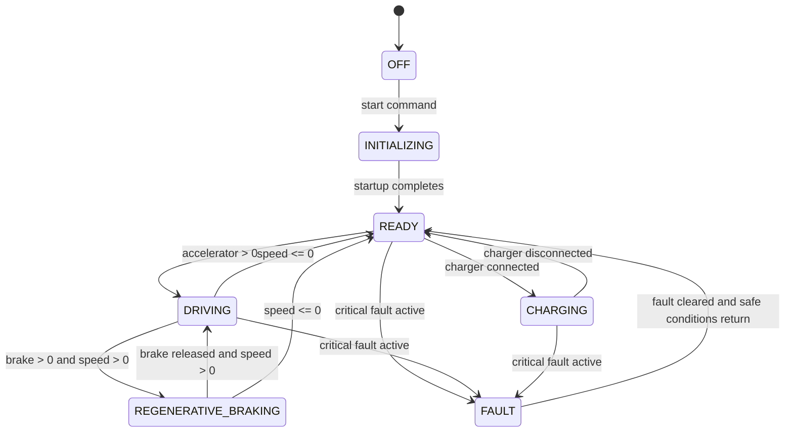

# SDV Functional Prototype V1

This project is a software-only digital model of an electric vehicle. Instead of controlling a real EV, it simulates the main vehicle functions in software: vehicle state, battery behavior, motor torque, charging, faults, and dashboard updates.

The goal is not to build a real vehicle controller. The goal is to make the system understandable, modular, and demonstrable in a student engineering project. The code models an EV in a simplified but internally consistent way so that a user can interact with it through a dashboard and see the simulation respond in real time.

This repository is a Python + FastAPI backend with a static HTML/CSS/JavaScript frontend. The backend owns the simulation logic; the frontend does not calculate the physics. The dashboard simply displays the live state produced by the backend.

---

## 1. Big picture

The project is organized around a simulation engine that behaves like a simplified EV control system.

```text
                 DRIVER / USER
                       |
                       v
                DASHBOARD / HMI
                       |
                       v
                      API
                       |
                       v
                     VCU
              /        |        \
             /         |         \
            v          v          v
          BMS      MOTOR        DIAGNOSTICS
            |       CONTROLLER      |
            |          |            |
            v          v            v
        BATTERY      MOTOR      FAULT MANAGER
                       |
                       v
                VEHICLE DYNAMICS
                       |
                       v
                SIMULATION STATE
                       |
                       +-------> DASHBOARD
```

In this repository, that structure is implemented in a simplified way:

- The browser dashboard is the user interface.
- The Python backend provides HTTP endpoints and a WebSocket.
- The simulation engine runs the EV logic.
- The VCU decides whether the vehicle is allowed to drive or charge.
- The battery model updates SOC and temperature.
- The motor model calculates torque, RPM, and power.
- The vehicle model calculates speed and acceleration.
- Diagnostics turn measured conditions into active faults.
- The dashboard receives the latest state from the backend and updates the display.

---

## 2. Project structure

This is the actual repository structure:

```text
v1/
├── backend/
│   ├── __init__.py
│   ├── main.py
│   ├── api/
│   │   ├── __init__.py
│   │   └── routes.py
│   ├── models/
│   │   ├── battery_state.py
│   │   ├── diagnostics_state.py
│   │   ├── motor_state.py
│   │   └── vehicle_state.py
│   └── simulation/
│       ├── __init__.py
│       ├── battery_model.py
│       ├── charging.py
│       ├── diagnostics.py
│       ├── motor_model.py
│       ├── simulation_engine.py
│       ├── state_machine.py
│       ├── vehicle_model.py
│       └── vcu.py
├── frontend/
│   ├── app.js
│   ├── index.html
│   └── styles.css
├── tests/
│   └── test_simulation.py
├── requirements.txt
├── README.md
└── .venv/
```

### What each important folder/file does

#### backend/main.py

This is the FastAPI application entry point. It:

- creates the app
- serves the frontend files
- mounts the static frontend assets
- includes the API router
- starts a background simulation loop during app startup
- sends live simulation data through the WebSocket

It is the main runtime launcher for the backend service.

#### backend/api/routes.py

This contains the HTTP API and the WebSocket server. It defines the endpoints that the frontend calls and the connection manager used for broadcasting updates.

This file is the communication layer between the JavaScript dashboard and the Python simulation engine.

#### backend/simulation/simulation_engine.py

This is the central simulation engine. It owns the model objects and the time loop. It updates the battery, motor, charger, diagnostics, vehicle dynamics, and state machine. It is the main orchestration file for the EV simulation.

#### backend/simulation/state_machine.py

This file defines the actual vehicle state machine using Python `Enum` values.

#### backend/simulation/vcu.py

This file represents the VCU logic. It decides whether driving or charging is allowed, and whether regenerative braking should be active.

#### backend/simulation/battery_model.py

This file represents the battery. It stores SOC, voltage, current, temperature, status, and it updates the battery as energy is consumed or recovered.

#### backend/simulation/motor_model.py

This file represents the motor. It converts the requested torque into motor RPM, motor power, and temperature.

#### backend/simulation/vehicle_model.py

This file represents the vehicle body and motion. It calculates acceleration, speed, distance traveled, and energy accounting.

#### backend/simulation/charging.py

This file models plugging in the charger and charging the battery while the vehicle is stationary.

#### backend/simulation/diagnostics.py

This file stores the fault definitions and determines whether a fault is active based on measured conditions.

#### backend/models/\*.py

These files are Pydantic data models. They define the structure used for typed state, battery state, motor state, and diagnostics. They are not the main simulation logic, but they help structure the data flowing through the system.

#### frontend/index.html

This is the single-page dashboard. It contains the layout, status cards, charts, controls, fault panel, and architecture display.

#### frontend/app.js

This is the frontend logic. It:

- calls the API
- updates dashboard values
- opens the WebSocket
- updates charts
- handles button clicks and slider inputs

#### frontend/styles.css

This file controls the styling of the engineering dashboard.

#### tests/test_simulation.py

This contains the actual tests for the state machine and VCU logic.

---

## 3. Dependencies explained

The repository contains a Python `requirements.txt` but no `package.json` file. The frontend is not a React app; it is a plain HTML/JavaScript page that loads Chart.js from a CDN.

### requirements.txt

```text
fastapi==0.115.0
uvicorn==0.30.6
pydantic==2.9.2
python-multipart==0.0.1
pytest==8.3.3
```

| Dependency       | What it is                         | Why this project uses it                                               |
| ---------------- | ---------------------------------- | ---------------------------------------------------------------------- |
| FastAPI          | Python web framework               | Creates the backend API and WebSocket endpoints                        |
| Uvicorn          | ASGI server                        | Runs the FastAPI app in production/dev                                 |
| Pydantic         | Data validation and schema library | Validates API input and structures simulation data                     |
| python-multipart | Form-data parser                   | Included for multipart form handling; not heavily used in this project |
| pytest           | Testing framework                  | Verifies the state machine and VCU logic                               |

### Important practical explanation

This project uses Python because the simulation logic is easiest to write and reason about in Python. The backend can run directly on the workstation, the business logic is clear, and the models are easier to maintain than a large frontend-only calculation system.

FastAPI is used because it gives a simple way to expose:

- `GET /api/state`
- POST commands for start/stop/reset/input changes
- WebSocket live updates

Pydantic is used to validate request objects such as:

- `DriverCommand`
- `FaultCommand`

Without Pydantic, the backend would have to manually check field validity and types.

The frontend is not React-based in this repository. Instead, plain JavaScript uses `fetch()` to call the backend and `WebSocket` to receive streaming state updates.

---

## 4. Software concepts you need to understand

### 4.1 Backend

A backend is the part of an application that runs on a server and handles logic, data processing, and communication. In this project, the backend is the Python code that owns the EV simulation.

The backend is responsible for:

- receiving driver inputs
- updating the battery, motor, and vehicle models
- checking safety conditions
- changing vehicle state
- broadcasting the current state to the frontend

### 4.2 Frontend

A frontend is the part the user interacts with. In this project, the frontend is the HTML/CSS/JavaScript dashboard. It displays values and sends user inputs like accelerator and brake settings.

The frontend does not calculate vehicle physics. It only displays the live simulation state sent by the backend.

### 4.3 API

An API is a way for software modules to talk to each other. Here, the frontend talks to the backend through HTTP endpoints.

Examples in this repository:

- `GET /api/state` → get the latest state
- `POST /api/start` → start the simulation
- `POST /api/inputs` → send accelerator and brake values
- `POST /api/fault` → inject a fault
- `POST /api/charger/connect` → connect charger

HTTP is request/response based: browser asks the server, server responds.

### 4.4 WebSocket

A WebSocket is a persistent real-time connection between client and server. It is different from normal HTTP requests because it stays open instead of closing after each response.

In this project:

- the frontend opens a WebSocket to `/api/ws`
- the backend broadcasts the simulation state repeatedly while the simulation is running
- the dashboard updates live without needing to keep polling manually

This is useful because the EV model is continuously changing as time advances.

### 4.5 JSON

JSON is the data format used for sending information between frontend and backend. It is a simple text format that looks like a dictionary or object.

Example from the simulation state:

```json
{
  "vehicle": {
    "state": "READY",
    "speed_kph": 18.4,
    "acceleration_mps2": 0.56
  },
  "battery": {
    "soc": 78.2,
    "temperature": 31.4,
    "power_kw": 12.6
  }
}
```

The frontend receives this JSON and updates the dashboard.

### 4.6 Pydantic models

Pydantic is used to define structured Python data models. These models validate input and describe the expected schema.

Examples in this repository:

- `DriverCommand` in `backend/api/routes.py`
- `FaultCommand` in `backend/api/routes.py`
- `VehicleStateModel` in `backend/models/vehicle_state.py`
- `BatteryState`, `MotorState`, `DiagnosticsState`

A Pydantic model is more reliable than a raw dictionary because you can enforce types and value ranges.

### 4.7 Classes and objects

A class is a blueprint for an object. An object is a real instance created from that class.

Important classes in this project:

- `VehicleState` (enum, not a normal class but a type)
- `StateMachine`
- `VCU`
- `BatteryModel`
- `MotorModel`
- `VehicleModel`
- `ChargingSystem`
- `Diagnostics`
- `SimulationEngine`

These objects are created in the simulation engine and then updated each timestep.

### 4.8 Modules

A Python module is a file containing Python code. Splitting the project into modules keeps the software understandable.

This project separates:

- API code
- models
- simulation logic
- frontend assets
- tests

That separation makes it easier to understand the architecture and later replace pieces without rewriting the whole project.

### 4.9 Async / background loop

The backend uses `asyncio.create_task` to start a background loop. This loop keeps the simulation ticking in the background while the app is running.

This is important because the EV simulation is continuous. The code is not run only when a user clicks a button; it keeps updating over time.

---

## 5. State machine: the heart of the EV logic

A state machine is a way of representing a system that can only be in a limited set of states and moves between them according to rules.

A simple example is a traffic light:

```text
RED -> GREEN -> YELLOW -> RED
```

For an EV, the state describes the current operating mode. Instead of letting the system behave in an uncontrolled way, the code explicitly defines which states are valid and what conditions allow transition between them.

### States in this project

The actual enum is defined in `backend/simulation/state_machine.py`:

```python
class VehicleState(str, Enum):
    OFF = "OFF"
    INITIALIZING = "INITIALIZING"
    READY = "READY"
    DRIVING = "DRIVING"
    REGENERATIVE_BRAKING = "REGENERATIVE_BRAKING"
    CHARGING = "CHARGING"
    FAULT = "FAULT"
```

These are the actual states used by the simulation.

### What each state means

#### OFF

The vehicle is off.

#### INITIALIZING

The system has started but is not yet ready to drive.

#### READY

The vehicle has completed startup and is ready to accept driver commands.

#### DRIVING

The vehicle is moving under propulsion.

#### REGENERATIVE_BRAKING

The driver is pressing the brake, and the motor is acting as a generator to recover energy.

#### CHARGING

The charger is connected and charging power is being applied.

#### FAULT

A critical condition is active, so the vehicle enters a safe fault state.

### Actual transition rules in code

The implementation is in `StateMachine.update()`.

```python
if critical_fault_active:
    return VehicleState.FAULT

if state in (VehicleState.OFF, VehicleState.FAULT):
    if state == VehicleState.OFF:
        state = VehicleState.INITIALIZING
    elif state == VehicleState.FAULT:
        state = VehicleState.READY
    return state

if state == VehicleState.INITIALIZING:
    state = VehicleState.READY
    return state

if state == VehicleState.READY:
    if charger_connected:
        return VehicleState.CHARGING
    if accelerator > 0 and speed_kph >= 0:
        return VehicleState.DRIVING
    return VehicleState.READY

if state == VehicleState.DRIVING:
    if brake > 0 and speed_kph > 0:
        return VehicleState.REGENERATIVE_BRAKING
    if speed_kph <= 0:
        return VehicleState.READY
    return VehicleState.DRIVING

if state == VehicleState.REGENERATIVE_BRAKING:
    if brake <= 0 or speed_kph <= 0:
        return VehicleState.READY if speed_kph <= 0 else VehicleState.DRIVING
    return VehicleState.REGENERATIVE_BRAKING

if state == VehicleState.CHARGING:
    if not charger_connected:
        return VehicleState.READY
    return VehicleState.CHARGING
```

### State transitions in plain language

- `OFF` -> `INITIALIZING` when the simulation starts.
- `INITIALIZING` -> `READY` immediately.
- `READY` -> `DRIVING` when accelerator is pressed.
- `READY` -> `CHARGING` when charger is connected.
- `DRIVING` -> `REGENERATIVE_BRAKING` when brake is pressed while speed is positive.
- `DRIVING` -> `READY` when speed reaches zero.
- `REGENERATIVE_BRAKING` -> `DRIVING` or `READY` depending on brake and speed.
- `CHARGING` -> `READY` when charger is disconnected.
- Any state -> `FAULT` when a critical fault is active.

### How invalid transitions are prevented

This is a key engineering concept. The logic does not allow arbitrary switching between states. Instead, the state machine checks conditions before changing state. If the condition is not met, the state remains the same or transitions to a safe state.

This prevents things like:

- driving while charging
- driving during a critical fault
- allowing acceleration while the charger is connected

---

## 6. Actual transition diagram



This is a simplified but accurate representation of the implemented logic.

---

## 7. The VCU (Vehicle Control Unit)

The VCU is the central decision-maker for vehicle operation. It is implemented in `backend/simulation/vcu.py`.

Conceptually, the VCU is like the brain of the vehicle. It takes driver input and system conditions and decides what the vehicle is allowed to do.

### The actual VCU logic

```python
critical_faults = {
    "HIGH_BATTERY_TEMPERATURE",
    "LOW_BATTERY_SOC",
    "MOTOR_OVERTEMPERATURE",
    "COMMUNICATION_FAILURE",
}
```

The function `VCU.evaluate()` returns a decision dictionary with:

- `drive_allowed`
- `charging_allowed`
- `regenerative_braking`
- `requested_torque_nm`
- `power_limit_kw`
- `status`
- `reason`

### Conditions that block drive

Drive is allowed only when:

- vehicle state is READY, DRIVING, or REGENERATIVE_BRAKING
- charger is not connected
- no communication failure is active
- no critical fault is active
- battery SOC is above 10%
- battery temperature is below 60°C
- motor temperature is below 95°C

This is a direct safety gate.

### Why that matters

Without this logic, the vehicle could try to drive with an unsafe battery or a faulted system. The VCU enforces the rule that the system cannot drive under unsafe conditions.

### Regenerative braking logic

Regenerative braking is enabled only when:

- state is DRIVING or REGENERATIVE_BRAKING
- brake > 0
- accelerator is zero
- charger is disconnected
- no critical fault active
- no communication failure

The VCU does not do the full physics itself. It only decides whether regenerative braking is allowed.

---

## 8. Battery model

The battery model is in `backend/simulation/battery_model.py`.

### Battery parameters in the code

```python
self.capacity_kwh = 60.0
self.soc = initial_soc  # 80.0 by default
self.voltage = 360.0
self.temperature = 30.0
self.available_power_kw = 70.0
```

So the simulation starts with:

- 60 kWh battery
- 80% SOC
- 360 V nominal battery voltage
- 30°C initial temperature

### How SOC changes

The battery model uses a simple energy accounting model.

When the battery is discharging:

```python
energy_change_percent = (abs(power_kw) * dt / 3600.0 / self.capacity_kwh) * 100.0
self.soc = max(0.0, self.soc - energy_change_percent)
```

When the battery is charging:

```python
energy_change_kwh = self.charging_power_kw * dt / 3600.0
self.soc = min(100.0, self.soc + (energy_change_kwh / self.capacity_kwh) * 100.0)
```

This is a simplified but practical model. It converts power and time into a fraction of total battery capacity.

### Battery status values

The battery can report:

- `OK`
- `CHARGING`
- `DISCHARGING`
- `REGENERATING`
- `IDLE`

### Battery temperature behavior

Battery temperature increases when charging or discharging power is high.

Examples:

```python
self.temperature = min(60.0, self.temperature + 0.02 * self.charging_power_kw)
self.temperature = min(60.0, self.temperature + 0.01 * abs(power_kw))
```

This is a simple thermal response model, not a detailed electrochemical model.

### Battery limits

- SOC is clamped between 0 and 100%
- temperature is capped at 60°C in the battery model
- available power is reduced as temperature rises

### Battery current and power

The model computes current using power and voltage:

```python
self.current = power_kw / max(self.voltage / 1000.0, 0.1)
```

This is a simplified electrical relationship that approximates how current changes with power.

---

## 9. Motor model

The motor model is in `backend/simulation/motor_model.py`.

### Motor parameters in the code

```python
self.max_torque_nm = 250.0
self.max_power_kw = 100.0
self.temperature = 35.0
```

This functions as a prototype EV motor for the simulation.

### Motor update logic

The motor receives a requested torque and then updates:

- RPM
- requested torque
- actual torque
- electrical power
- temperature

```python
speed_mps = speed_kph / 3.6
wheel_radius = 0.30
wheel_rpm = (speed_mps / (2 * 3.14159 * wheel_radius)) * 60.0
self.rpm = max(0.0, wheel_rpm * 4.0)
```

The formula converts vehicle speed into wheel RPM, then scales it to motor RPM.

Then:

```python
self.requested_torque_nm = max(-torque_limit, min(torque_limit, requested_torque_nm))
self.actual_torque_nm = self.requested_torque_nm
```

This means the real torque is bounded by the motor torque limit.

### Power calculation

The code calculates motor power using a basic rotational power relation:

```python
angular_speed_rad_s = self.rpm * 2 * 3.14159 / 60.0
self.power_kw = (self.actual_torque_nm * angular_speed_rad_s) / 1000.0
```

This is the same idea as:

```text
Power = Torque × Angular Speed
```

### Why is this important?

The motor produces torque, which creates force at the wheel, which then creates acceleration. The vehicle speed changes because the motor is effectively pushing the vehicle forward.

---

## 10. Vehicle dynamics

The vehicle dynamics are implemented in `backend/simulation/vehicle_model.py`.

This is where the simulation converts motor torque into acceleration and speed.

### Forces modeled in the code

```python
rolling_resistance_n = 0.01 * mass * 9.81
drag_force_n = 0.5 * air_density * drag_coefficient * frontal_area_m2 * speed_mps * speed_mps
brake_force_n = (brake_percent / 100.0) * 6000.0
motor_force_n = (motor_torque_nm / self.wheel_radius_m) if speed_mps >= 0 else 0.0
```

This means the code includes:

- rolling resistance
- aerodynamic drag
- brake force
- motor force

Then it calculates net force:

```python
net_force_n = motor_force_n - rolling_force_n - drag_force_n - brake_force_n
self.acceleration_mps2 = net_force_n / mass
```

This follows Newton's second law:

```text
F = ma
```

Then vehicle speed is updated:

```python
self.speed_kph = max(0.0, self.speed_kph + (self.acceleration_mps2 * dt * 3.6))
```

This converts acceleration from m/s² into kph over the time step.

### Distance traveled

```python
self.distance_km += (self.speed_kph * dt / 3600.0)
```

This approximates distance as speed × time in km.

### Important modeling note

This is a simplified prototype model. It is not a high-fidelity EV physics model. It captures the basic behavior: greater torque → more acceleration, more braking → more deceleration, more speed → more drag, and battery power changes with load.

---

## 11. Regenerative braking

Regenerative braking is a key feature of the project and is implemented in the simulation engine and the VCU.

### Concept

When a vehicle is moving and the driver presses the brake, the motor can operate as a generator. Instead of wasting energy as heat in friction brakes, the motor converts mechanical energy back into electrical energy and sends it to the battery.

### The actual behavior in this repository

The simulation engine checks for regenerative braking when in a driving state:

```python
if self.current_state in {VehicleState.DRIVING, VehicleState.REGENERATIVE_BRAKING}:
    if vcu_decision["regenerative_braking"] or brake > 0:
        self.current_state = VehicleState.REGENERATIVE_BRAKING
        requested_torque = -min(200.0, brake * 2.8)
```

Notice how it sets a negative requested torque. That means the motor torque becomes negative, which acts opposite to the direction of motion.

Then the simulation does:

```python
power_kw = -max(0.0, self.motor.actual_torque_nm * self.motor.rpm * 2 * 3.14159 / 60.0 / 1000.0)
self.battery.update(power_kw=power_kw, dt=dt, charging=False)
self.vehicle_model.energy_recovered_kwh += max(0.0, abs(power_kw) * dt / 3600.0) * 0.35
self.vehicle_model.speed_kph = max(0.0, self.vehicle_model.speed_kph - (brake / 100.0) * 25.0 * dt)
```

This means:

- motor torque becomes negative
- vehicle speed is reduced
- electrical energy is returned to the battery
- recovered energy is tracked in `energy_recovered_kwh`

### Important note

The project does not attempt a perfect regenerative braking model. The code applies a simplified conversion and a recovery factor. The point is to demonstrate that braking can reduce speed while charging the battery.

---

## 12. Charging model

The charging logic is in `backend/simulation/charging.py` and is coordinated by the simulation engine.

### Charger operation

The `ChargingSystem` has:

- `connected` flag
- `charging_power_kw`
- `energy_delivered_kwh`
- `status`

When the user connects the charger:

```python
self.connected = True
self.status = "CONNECTED"
self.charging_power_kw = 50.0
```

During update:

```python
if self.connected and vehicle_stationary:
    self.status = "CHARGING"
    self.charging_power_kw = 50.0
    self.energy_delivered_kwh += self.charging_power_kw * dt / 3600.0
```

This is a simplified charger model.

### Charging vs vehicle state

The charging path is only valid when the vehicle is stationary. The simulation does not allow the vehicle to drive while the charger is connected. The VCU and state machine enforce this safety rule.

### Charging battery effect

In `SimulationEngine.tick()`, charging does:

```python
self.charger.update(dt, vehicle_stationary=self.vehicle_model.speed_kph <= 0.0)
self.battery.update(power_kw=self.charger.charging_power_kw, dt=dt, charging=True)
```

The battery model then increases SOC based on the charging power.

---

## 13. Diagnostics and faults

The diagnostics module is in `backend/simulation/diagnostics.py`.

### Implemented faults

The repository contains these fault definitions:

- `HIGH_BATTERY_TEMPERATURE`
- `LOW_BATTERY_SOC`
- `MOTOR_OVERTEMPERATURE`
- `COMMUNICATION_FAILURE`

Each fault contains:

- code
- name
- severity
- description
- active flag

### Fault detection logic

The diagnostics update function checks conditions:

```python
self.faults["HIGH_BATTERY_TEMPERATURE"]["active"] = battery_temp > 55.0
self.faults["LOW_BATTERY_SOC"]["active"] = soc < 10.0
self.faults["MOTOR_OVERTEMPERATURE"]["active"] = motor_temp > 95.0
self.faults["COMMUNICATION_FAILURE"]["active"] = communication_failure
```

Then it computes a system health value:

```python
self.system_health = max(0.0, 100.0 - len(active) * 20.0)
```

### How faults affect vehicle behavior

The simulation engine collects active faults and then forces the state machine into `FAULT` when any critical condition exists:

```python
if self.active_faults or self.communication_failure:
    self.current_state = VehicleState.FAULT
```

This means the vehicle can no longer safely continue normal operation while a critical fault is active.

### What the dashboard displays

The frontend reads `stateData.diagnostics.active_faults` and prints the list. It also shows the battery status, motor status, and communication status.

---

## 14. Central SimulationState

The project does not use one big class per model in a rigid formal schema; instead the simulation engine assembles a dictionary-like state object with fields such as:

- `vehicle`
- `driver`
- `battery`
- `motor`
- `energy`
- `charging`
- `diagnostics`
- `system_status`

The actual state is returned by `SimulationEngine.get_state()`.

Example structure from the code:

```python
state = {
    "timestamp": time.time() - self.start_time,
    "vehicle": {
        "state": self.current_state.value,
        "speed_kph": round(self.vehicle_model.speed_kph, 2),
        "acceleration_mps2": round(self.vehicle_model.acceleration_mps2, 3),
        "distance_km": round(self.vehicle_model.distance_km, 3),
    },
    "driver": {
        "accelerator": round(self.driver_inputs["accelerator"], 2),
        "brake": round(self.driver_inputs["brake"], 2),
        "charger_connected": self.charger.connected,
    },
    "battery": {
        **self.battery.get_state(),
        "available_power_kw": round(self.battery.available_power_kw, 2),
        "power_kw": round(self.battery.current * self.battery.voltage / 1000.0, 2),
    },
    "motor": self.motor.get_state(),
    "energy": {
        "energy_consumed_kwh": round(self.vehicle_model.energy_consumed_kwh, 3),
        "energy_recovered_kwh": round(self.vehicle_model.energy_recovered_kwh, 3),
        "net_energy_consumed_kwh": round(self.vehicle_model.net_energy_kwh, 3),
    },
    "charging": self.charger.get_state(),
    "diagnostics": health,
    "system_status": {...},
}
```

This dictionary is the single source of truth used by the dashboard.

### Why this is important

Every live dashboard value comes from this state object, not from a separate UI-only calculation. This means the frontend is a visualization of the backend simulation state.

---

## 15. Simulation loop and time advancement

The central simulation loop is in `SimulationEngine.tick()`.

This function executes with a time step of 0.1 seconds by default.

### Actual simulation order in the code

The real execution order is:

1. Read driver inputs from `self.driver_inputs`
2. Check whether the vehicle is OFF or in FAULT
3. Evaluate active faults
4. Run the state machine update
5. If CHARGING: update charger and battery charging behavior
6. Else: evaluate VCU rules and decide requested torque
7. Update the motor model
8. If regenerative braking: recover energy and reduce speed
9. If driving: discharge battery and track energy consumption
10. Update the vehicle dynamics model
11. Run diagnostics again
12. Update the battery power availability
13. Save data to history
14. Return the latest state

This order matters because the simulation uses the previous state and the new inputs together to produce a consistent next snapshot.

The loop is run continuously in the background by `backend/main.py`:

```python
async def background_simulation_loop():
    while True:
        if engine.running:
            engine.tick(dt=0.1)
            await manager.broadcast(engine.get_state())
        await asyncio.sleep(0.1)
```

This means the backend repeatedly advances time and broadcasts the latest state to any connected frontend.

---

## 16. API endpoints and WebSocket implementation

The API is defined in `backend/api/routes.py`.

### HTTP endpoints

#### GET /api/state

Returns the current simulation state.

#### POST /api/start

Sets the simulation as running and sets the state to `INITIALIZING`.

#### POST /api/stop

Stops the simulation and sets the state to `OFF`.

#### POST /api/reset

Resets all simulation components.

#### POST /api/inputs

Accepts:

```json
{
  "accelerator": 50,
  "brake": 0,
  "charger_connected": false
}
```

This updates the driver inputs.

#### POST /api/charger/connect

Connects the charger and sets the charger flag to active.

#### POST /api/charger/disconnect

Disconnects the charger.

#### POST /api/fault

Injects a named fault.

#### POST /api/fault/clear

Clears a named fault.

### WebSocket

The WebSocket endpoint is defined as:

```python
@router.websocket("/ws")
async def vehicle_ws(websocket: WebSocket):
    await manager.connect(websocket)
    try:
        while True:
            await websocket.receive_text()
    except WebSocketDisconnect:
        manager.disconnect(websocket)
```

The backend uses a `ConnectionManager` to maintain active client connections and send JSON messages to them.

---

## 17. Frontend communication path

The frontend JavaScript in `frontend/app.js` is responsible for talking to the backend.

### Example communication flow

```text
User moves accelerator slider
      |
      v
JavaScript calls POST /api/inputs
      |
      v
FastAPI route receives DriverCommand
      |
      v
SimulationEngine.apply_driver_inputs()
      |
      v
State machine and physics update
      |
      v
SimulationEngine.get_state()
      |
      v
Frontend receives response JSON
      |
      v
Dashboard updates text and charts
```

### WebSocket flow

```text
SimulationEngine.tick()
      |
      v
background_simulation_loop()
      |
      v
await manager.broadcast(engine.get_state())
      |
      v
WebSocket sends JSON to browser
      |
      v
updateDashboard(data)
```

The frontend is intentionally thin. It does not compute the physics. It simply updates the interface from the backend state.

---

## 18. Frontend dashboard

The dashboard is built in `frontend/index.html` and styled via `frontend/styles.css`.

It shows:

- vehicle speed
- vehicle state
- battery SOC
- battery power
- motor torque
- motor RPM
- energy consumed and recovered
- charging power
- VCU/BMS/motor/communication status
- active faults
- live charts for speed, SOC, and battery power

### Important frontend behavior

The file `frontend/app.js` contains these core functions:

- `apiCall()` - generic HTTP request helper
- `updateDashboard()` - updates DOM elements with new data
- `updateCharts()` - pushes new data into Chart.js
- `handleInputChange()` - sends slider values to the backend
- `connectSocket()` - opens the WebSocket
- `bindEvents()` - connects buttons and sliders to actions

### Controls in the UI

The dashboard includes:

- Start Vehicle
- Stop Vehicle
- Reset Simulation
- Accelerator slider
- Brake slider
- Connect Charger
- Disconnect Charger
- Fault selection and injection
- Demo buttons for startup, driving, regenerative braking, charging, and fault demonstration

---

## 19. What happens when you press controls?

### Accelerator

When the user moves the accelerator slider:

1. The frontend sends a POST to `/api/inputs`
2. The backend stores the new input value
3. `SimulationEngine.tick()` reads it in the next simulation step
4. The state machine may transition to `DRIVING`
5. The motor model generates torque
6. The vehicle model accelerates the vehicle
7. The battery discharges power
8. The dashboard shows the new values

### Brake

When the user increases the brake slider:

1. The backend receives the new brake value
2. The state machine may transition to `REGENERATIVE_BRAKING`
3. The VCU enables regenerative braking
4. Motor torque becomes negative
5. Vehicle speed decreases
6. Battery recovers energy
7. The dashboard shows lower speed and higher recovered energy

### Charger connection

When the user connects the charger:

1. The frontend calls `/api/charger/connect`
2. `ChargingSystem.connect()` is called
3. `charger_connected` becomes true
4. The state machine can move to `CHARGING`
5. The battery gets charge power
6. SOC rises gradually
7. The dashboard shows charging power and battery increase

### Fault injection

When the user injects a fault:

1. The frontend calls `/api/fault`
2. `engine.set_fault()` marks the fault active
3. `SimulationEngine.tick()` sees a critical fault
4. The state machine may move to `FAULT`
5. VCU restrictions apply
6. Dashboard shows the active fault and status change

---

## 20. Real vs simulated

| System           | Real implementation? | Simulated? | Explanation                                             |
| ---------------- | -------------------- | ---------- | ------------------------------------------------------- |
| Battery model    | No                   | Yes        | Simplified SOC and temperature dynamics                 |
| Motor model      | No                   | Yes        | Basic torque, RPM, power relationship                   |
| VCU logic        | No                   | Yes        | Safety and state gating logic is simulated              |
| Vehicle dynamics | No                   | Yes        | Acceleration, drag, resistance, speed update            |
| Charging system  | No                   | Yes        | Simplified power flow and connection model              |
| Diagnostics      | No                   | Yes        | Fault detection using threshold logic                   |
| Dashboard        | Yes, as UI           | Partly     | It displays the backend state, but has no real hardware |
| Battery hardware | No                   | No         | Not physically connected                                |
| CAN bus          | No                   | No         | Not implemented                                         |

This project is a software prototype. It is intentionally simplified and is meant to demonstrate the architecture and behavior, not to be a full engineering-grade EV controller.

---

## 21. Engineering assumptions and simplifications

This project is intentionally simplified, and the code makes that clear.

### Actual prototype values

From the code:

- vehicle mass = 1500 kg
- wheel radius = 0.30 m
- battery capacity = 60 kWh
- initial SOC = 80%
- max motor torque = 250 Nm
- max motor power = 100 kW
- initial battery temperature = 30°C
- simulation timestep = 0.1 s

### Why these matter

These values are used in:

- `VehicleModel.__init__()`
- `MotorModel.__init__()`
- `BatteryModel.__init__()`
- `SimulationEngine.tick()`

They define the simulation response, not the exact physical behavior of a production EV.

### Simplifications to be aware of

- SOC is computed with a simple percentage-of-capacity formula
- motor power uses a simplified rotational power equation
- vehicle dynamics includes drag and rolling resistance but not road slope or complex tire modeling
- charging power is fixed at 50 kW in this implementation
- faults are threshold-based rather than true diagnostic algorithms
- there is no real sensor network or CAN communication stack

This is okay for a student prototype because the goal is to show how the system behaves and how the architecture is organized.

---

## 22. MATLAB/Simulink integration roadmap

This section is intentionally separate from the current implementation. The repository does not currently contain a MATLAB or Simulink dependency, and there is no live MATLAB model connected to the app as of the current codebase.

### CURRENT — IMPLEMENTED

The current system is a Python-based SDV prototype with the following structure:

```text
                React-free browser dashboard
                          ↑
                          |
                 WebSocket / HTTP
                          ↑
                          |
                     FastAPI backend
                          ↑
                          |
                 Python simulation engine
                 /      |       |       \
                /       |       |        \
               v        v       v         v
             VCU     State Machine   Battery   Motor
                          |              |        |
                          v              v        v
                  Vehicle Dynamics     Diagnostics  Charging
```

This is the baseline that is actually present in the repository today. The backend is the source of truth, the frontend is only a presentation layer, and the simulation logic is deliberately simple and inspectable.

### FUTURE — PROPOSED

A future MATLAB/Simulink integration could be added as a more detailed dynamic model layer without changing the rest of the system too dramatically.

```text
                    Browser dashboard
                          ↑
                          |
                 FastAPI + WebSocket
                          ↑
                          |
                 Python integration layer
                          ↑
                          |
               MATLAB / Simulink model
             /        |          |         \
            /         |          |          \
           v          v          v           v
      Vehicle model  Battery model  Motor model  Control logic
           ↓          ↓          ↓            ↓
       Outputs -> Python SimulationState -> Dashboard
```

This is a realistic future architecture, not an implemented feature. The important idea is that the dashboard should not need to know whether the underlying values came from Python or from a MATLAB/Simulink model. The Python integration layer should translate the results into the existing simulation-state schema.

---

### Why MATLAB/Simulink could be useful

MATLAB and Simulink are useful when the team wants more detailed modelling of dynamics and control systems. In beginner-friendly engineering terms:

- MATLAB is the numerical computing environment.
- Simulink is a block-based modelling environment for dynamic systems.
- A model represents the behaviour of a system over time.
- A block is a reusable subsystem that takes signals in and produces signals out.
- A solver is the numerical method that advances the model over time.
- A timestep defines how often the model updates.
- Inputs and outputs are the signals flowing through the blocks.
- A subsystem is a smaller grouped part of a larger system.
- The MATLAB workspace stores variables and parameter sets used during simulation.

For this project, MATLAB/Simulink could add more detailed modelling of:

- battery dynamics and thermal behavior
- motor and inverter characteristics
- vehicle longitudinal dynamics
- regenerative braking efficiency
- control system tuning
- energy management strategies

That said, MATLAB should be viewed as an option for deeper modelling, not as a requirement for the current repository to function.

---

### Approach A — MATLAB/Simulink as the simulation engine

In this option, Python remains responsible for:

- the API layer
- dashboard communication
- orchestration and control logic
- WebSocket and state broadcasting

MATLAB/Simulink becomes the detailed physical model. The Python layer sends simulation inputs to the MATLAB model, receives outputs, and reformats them into the same vehicle-state structure already used by the current system.

```text
React-free dashboard
         ↓
FastAPI
         ↓
Python integration layer
         ↓
MATLAB / Simulink model
         ↓
Vehicle / battery / motor outputs
         ↓
SimulationState
         ↓
Dashboard update
```

This approach is useful when the team wants more realistic physical modelling while keeping the same current system interface.

---

### Approach B — Python remains the main simulation engine

In this option, MATLAB/Simulink is used for:

- validating a detailed subsystem model
- comparing torque or energy behaviour against the Python model
- tuning control parameters
- generating reference outputs for a later system upgrade

This is a lower-risk path because the repository stays stable and the Simulink model acts as a validation or reference environment instead of the system-of-record.

```text
Python simulation engine
         ↑
         |
MATLAB / Simulink validation model
```

This is attractive when the team wants physical-model depth without changing the current architecture immediately.

---

### Realistic communication methods for future integration

#### Option 1 — MATLAB Engine API for Python

This is a direct Python-to-MATLAB interface. Python can start MATLAB, pass variables, run a model, and receive numerical results back. This is realistic for a lab or workstation environment where MATLAB is installed and licensed.

#### Option 2 — Generated code from Simulink

A Simulink subsystem can sometimes be converted to executable code, which may then be embedded into a larger application workflow. This is more advanced and not a simple plug-in for an existing app. It requires careful consideration of solver timing, interfacing, and requirements.

#### Option 3 — File-based exchange

MATLAB and Python can exchange data through CSV, MAT, or JSON files. This is simple to prototype but not ideal for high-frequency live simulation updates because it introduces file I/O overhead and timing jitter.

#### Option 4 — Network/API-based exchange

A future design could use a small service or network interface between MATLAB/Simulink and Python. The simulation could expose data over HTTP, TCP, or a local API boundary, and the Python layer could still publish vehicle state to the dashboard.

```text
MATLAB/Simulink ↔ Python adapter ↔ FastAPI ↔ Dashboard
```

This option keeps the architecture modular and keeps the user-facing UI stable.

---

### Phased roadmap

#### Phase 0 — Current system

The current architecture is the working baseline:

```text
Python simulation -> FastAPI -> WebSocket -> Dashboard
```

This is the stable reference implementation.

#### Phase 1 — Validate the current Python model

Before connecting MATLAB, the team should document:

- inputs and outputs of each model
- units for each signal
- timestep and update rate
- assumptions in the battery, motor, and vehicle dynamics models
- exact state-machine transitions
- limits and constraints used by the VCU

This makes the integration design much less error-prone.

#### Phase 2 — Select one subsystem to model in Simulink

A small first step is better than a full-system rewrite. For example, the team might start with:

- battery model
- vehicle dynamics model
- motor model
- regenerative braking subsystem

This reduces the risk of mismatched timestep or signal definitions.

#### Phase 3 — Define a standard interface

The integration layer should expose a normalized interface that matches the current `SimulationState` concept. For example, the interface could standardize inputs like:

- accelerator command
- brake command
- charger_connected flag
- simulation_time
- current vehicle state

And outputs like:

- speed_kph
- acceleration_mps2
- battery_soc
- battery_power_kw
- motor_torque_nm
- status flags

The exact names should match the current backend structure to keep the dashboard unchanged.

#### Phase 4 — Connect MATLAB/Simulink to Python

Once the interface is stable, the integration layer can translate between:

```text
Python inputs -> MATLAB/Simulink model -> Python outputs -> SimulationState -> Dashboard
```

This keeps the rest of the app largely unaware of the upstream model implementation.

#### Phase 5 — Replace or augment subsystems gradually

One subsystem at a time can be replaced with a MATLAB/Simulink equivalent. A safe approach is to maintain the same output interface while changing only the internal model source. That way, neither the API nor the dashboard needs a redesign.

---

### Interface design principle

The dashboard should not need to know whether the values came from a Python model or a MATLAB/Simulink model. This is a critical design rule.

```text
Python model        Simulink model
      \                    /
       \                  /
        ---> Integration Layer ---> SimulationState ---> Dashboard
```

That keeps the system modular: the front end sees a stable state contract regardless of what is behind it.

---

### Concrete example: replacing vehicle dynamics

The current architecture uses:

```text
Accelerator
   ↓
VCU
   ↓
Motor torque
   ↓
Python vehicle model
   ↓
Acceleration
   ↓
Speed
```

A future MATLAB/Simulink version could look like this:

```text
Accelerator
   ↓
VCU
   ↓
Motor torque
   ↓
Simulink vehicle dynamics model
   ↓
Acceleration
   ↓
Speed
   ↓
Python integration layer
   ↓
SimulationState
   ↓
Dashboard
```

The high-level behavior stays the same, but the physical calculation may become more detailed.

---

### What should not move to Simulink immediately

Not every part of the current project needs to move into MATLAB/Simulink. The following pieces are likely to remain in Python or the browser for a long time:

- FastAPI routes
- WebSocket management
- frontend dashboard logic
- user input handling
- general application orchestration
- state-machine safety logic

Simulink is most useful for dynamic physical and control-focused subsystems rather than the networking and UI layers.

---

### Proposed future folder layout

This is a future-looking structure only. It is not currently implemented in the repository.

```text
project/
├── backend/
├── frontend/
├── tests/
├── matlab/
│   ├── models/
│   │   ├── vehicle/
│   │   ├── battery/
│   │   └── motor/
│   ├── scripts/
│   └── README.md
└── README.md
```

This structure would clearly separate a MATLAB-specific modelling layer from the current Python and frontend modules.

---

### MATLAB/Simulink integration considerations

The following risks and practical issues matter before adopting MATLAB/Simulink:

- MATLAB licensing must be available on the target machines.
- Simulink version compatibility matters when sharing models.
- Simulation timestep differences can create inconsistency between Python and Simulink updates.
- Real-time execution is different from offline simulation.
- Data types and units must be translated carefully to avoid silent errors.
- Communication overhead can add delay or jitter.
- Model execution speed may affect the responsiveness of the dashboard.
- A competition or judging environment may not permit or include MATLAB.
- Portability may drop if the system depends on a local MATLAB installation.

These are important architectural considerations, not reasons to reject the approach outright.

---

### Do we actually need MATLAB?

A balanced view is necessary:

| Aspect                     | Python-only prototype  | Python + MATLAB/Simulink           |
| -------------------------- | ---------------------- | ---------------------------------- |
| Setup complexity           | Lower                  | Higher                             |
| Physics modelling depth    | Lower                  | Higher                             |
| Dashboard integration      | Simple                 | Still manageable                   |
| Portability                | Higher                 | Lower                              |
| Development speed          | Faster for prototyping | Slower due to integration effort   |
| Detailed control modelling | Limited                | Potentially richer                 |
| Competition readiness      | Good for software demo | Better for advanced modelling work |

The answer is not simply "MATLAB is better." The correct question is: does the team need more detailed dynamic modelling than the current prototype provides? If yes, MATLAB/Simulink may be worthwhile. If not, the current Python architecture is already sufficient for the demonstration and learning goals.

---

### Final takeaway on the future roadmap

The current repository is already a working software architecture for an SDV prototype. It has a clear simulation loop, explicit state machine, API and WebSocket flow, and a dashboard that visualizes live state. That makes it a strong anchor point for a later MATLAB/Simulink integration.

The most practical path is to preserve the current Python and dashboard architecture, add a thin integration layer, and only move detailed physical or control subsystems into MATLAB/Simulink when there is a clear reason to do so.

---

## 23. Testing

The test suite is in `tests/test_simulation.py`.

### Actual tests

#### `test_state_machine_ready_to_driving`

This verifies the vehicle transitions:

- OFF -> INITIALIZING
- INITIALIZING -> READY
- READY -> DRIVING when accelerator is applied

#### `test_vcu_blocks_drive_on_fault`

This verifies the VCU blocks normal drive when a critical fault is active.

#### `test_vcu_allows_regenerative_braking_when_safe`

This verifies regenerative braking is allowed when the vehicle is safe and braking is requested.

### Why these tests matter

They confirm the central safety logic and the explicit state machine. They do not test every UI detail or every mathematical model in full detail; they test the most important behavioral rules.

---

## 24. How to run this project

### Prerequisites

- Python 3.11+
- A terminal or command prompt
- Internet access for Chart.js CDN if the browser loads it from the web

### Install dependencies

```bash
cd "c:\Documents\Desktop\ses ev competition\v1"
C:/Users/user/AppData/Local/Programs/Python/Python313/python.exe -m pip install -r requirements.txt
```

### Run the backend

```bash
C:/Users/user/AppData/Local/Programs/Python/Python313/python.exe -m uvicorn backend.main:app --host 0.0.0.0 --port 8000
```

Then open the browser at:

```text
http://localhost:8000
```

### Notes

- The frontend is served by FastAPI from the `frontend/` folder.
- No Node.js or React build step is required in this repo.
- The app is designed as a simple local prototype.

---

## 25. Common issues and troubleshooting

### The backend does not start

Possible causes:

- missing dependencies
- Python version not compatible
- incorrect working directory

Check:

```bash
python --version
pip install -r requirements.txt
```

### Frontend cannot connect to backend

Check:

- the backend is running
- you are opening the correct URL
- the browser console has no WebSocket or fetch errors
- the API server is listening on port 8000

### WebSocket disconnects

This can happen if the backend stops or the app restarts. Refresh the browser and confirm the server is still running.

### Import errors

This often means Python cannot find the module structure. Make sure you are running the app from the repository root and that the package folder is named `backend`.

---

## 26. The most important thing to remember

This repository is not a real EV controller. It is a teaching simulation that demonstrates how an EV control architecture can be organized in software.

The actual logic flow is:

```text
Driver input
   -> API
   -> Simulation engine
   -> VCU
   -> Motor / Battery / Vehicle model
   -> Diagnostics / faults
   -> Simulation state
   -> WebSocket
   -> Dashboard
```

That flow is the real heart of the project.

---

## 27. How to read this codebase yourself

If you want to understand the project deeply, start in this order:

1. Read `backend/main.py` to understand app startup and the background loop.
2. Read `backend/api/routes.py` to see API and WebSocket behavior.
3. Read `backend/simulation/state_machine.py` to understand vehicle states.
4. Read `backend/simulation/vcu.py` to understand safety limitations.
5. Read `backend/simulation/simulation_engine.py` to see the full update order.
6. Read `backend/simulation/battery_model.py` to understand SOC and energy.
7. Read `backend/simulation/motor_model.py` to understand torque and motor power.
8. Read `backend/simulation/vehicle_model.py` to understand speed and acceleration.
9. Read `backend/simulation/diagnostics.py` to understand faults.
10. Read `frontend/app.js` to see how data is displayed and sent.
11. Read `tests/test_simulation.py` to see what behavior is considered correct.

This is the fastest way to understand the actual implementation in a beginner-friendly manner.

---

## 28. Final takeaway

This project is a simplified but realistic software demonstration of an EV control architecture. It models the main systems in a way that is easy to understand and easy to extend.

The most important idea is that the backend is the source of truth and the frontend is only a visual representation of that truth.

The project demonstrates:

- state-based vehicle operation
- safety logic through the VCU
- battery and motor behavior
- regenerative braking
- charging behavior
- fault detection and dashboard reporting
- real-time updates through WebSocket communication

That makes it useful both as a learning project and as a foundation for future expansion toward a more detailed model or a MATLAB/Simulink-based simulation pipeline.
